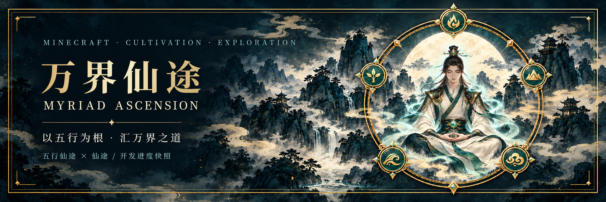

<div align="center">



**以五行为根，汇万界之道。**

融合修炼、丹器、术法与阵道的 Minecraft 修仙世界。


[源码入口](https://github.com/thezinecraftm-rgb/Myriad-Ascension/tree/main) · [下载与恢复](https://github.com/thezinecraftm-rgb/Myriad-Ascension/releases) · [融合进度](https://github.com/thezinecraftm-rgb/Myriad-Ascension/blob/main/docs/integration/CHECKLIST-16.md) · [反馈问题](https://github.com/thezinecraftm-rgb/Myriad-Ascension/issues)

</div>

## 一途为根，万法归一

《万界仙途 / Myriad Ascension》以 **《五行仙途》为主框架**，融合《仙途》的玩法与内容。修为、灵力、神识、职业与法宝主人数据沿用统一体系，让新增内容融入同一条修仙之路。

> **当前是开发进度快照，尚未完成整体验收。** 默认分支现已包含完整融合工程及近期已完成改动，后续开发通过功能分支与 PR 汇入。下载前请查看对应 Release 的说明，不要将历史恢复附件当作最新游戏安装包。

## 仙途百艺

| 修行方向 | 当前融合内容 |
| :-- | :-- |
| **修炼问道** | 境界成长、蒲团小游戏、元婴保命与修炼机制 |
| **丹道灵植** | 草药药龄、灵植培养、丹方传承、副药组合与天地为炉 |
| **炼器御宝** | 炼器辅材、强化精炼、认主温养、本命法宝与赐名 |
| **剑诀阵道** | 九霄剑诀、万剑归宗、诛仙四剑与诛仙剑阵 |
| **寻脉聚财** | 分级灵石、统一货币结算、神识探矿与灵脉罗盘 |
| **山海行囊** | 储物袋、磁铁、妖兽、精血毛皮、药浴与玩偶 |

*上表表示源码融合范围，不代表每项已完成实机验收。诛仙剑阵护罩目前为视觉效果，实际防御与阵法伤害另行设计。*

## 开发进展

| 阶段 | 状态 |
| :-- | :-- |
| **01–07 · 框架与生产体系** | 已完成阶段源码核对及专项修复，保留各项验收边界 |
| **08–13 · 玩法、界面与服务端回归** | 已有阶段报告；该阶段完整服务端回归 **339 / 339** 必需测试通过 |
| **近期界面适配** | 创造栏分类、宣纸山水风格、JEI 避让、分辨率及创造背包适配已在功能分支更新 |
| **14 · 客户端与外部光影** | 完整验收待进行 |
| **15 · 自然生成、存档与多人** | 真实生成、重载、旧档及多人矩阵待验收 |
| **16 · 正式交付** | 待上述验收完成后打包发布 |

历史测试结果只对应报告中的固定代码阶段，**不代表其后的所有改动已通过同一轮验证**。近期界面改动已编译打包，实机体验由测试反馈继续完善。

[查看完整 16 项清单 →](https://github.com/thezinecraftm-rgb/Myriad-Ascension/blob/main/docs/integration/CHECKLIST-16.md)

## 获取项目

### 想体验游戏

前往 [Releases](https://github.com/thezinecraftm-rgb/Myriad-Ascension/releases) 查看附件类型、版本和依赖说明。**恢复 bundle、交接 ZIP 与可安装 JAR 用途不同**；客户端与服务端应使用相同版本。当前下载内容仍按开发快照对待。

### 想阅读或参与开发

默认分支包含当前整合源码与近期背包、创造模式适配，可直接克隆：

```bash
git clone --branch main https://github.com/thezinecraftm-rgb/Myriad-Ascension.git
cd Myriad-Ascension
```

老 UI 交付基线、新 UI 暂存稿和早期融合快照继续保留在独立分支；未验收暂存稿不替换当前交付界面。

工程使用 **Minecraft 1.20.1 / Forge / JDK 17 / Gradle 8.8**，依赖与验证配置以该分支工程文件为准。

```powershell
# 构建游戏 JAR
.\gradlew.bat build

# 完整服务端验证：先安装 QA 工具依赖
python -m pip install -r tools/requirements-qa.txt
.\gradlew.bat verifyFull -PpythonExecutable=python --console=plain
```

Linux / macOS 使用 `./gradlew`。首次解析依赖需要联网；完整服务端验证不要混入客户端外部光影参数。

## 协作与资料

- [项目协作规则](https://github.com/thezinecraftm-rgb/Myriad-Ascension/blob/main/AGENTS.md)：功能分支与 PR 协作，保留他人改动，禁止强制覆盖。
- [已确认融合方案](https://github.com/thezinecraftm-rgb/Myriad-Ascension/blob/main/docs/integration/accepted-decisions.json)：重复玩法先确认取舍，不另建重复账户。
- [内容覆盖账本](https://github.com/thezinecraftm-rgb/Myriad-Ascension/blob/main/SOURCE_CONTENT_COVERAGE.md)：追踪来源内容与融合范围。
- [恢复与分支说明](https://github.com/thezinecraftm-rgb/Myriad-Ascension/blob/main/docs/integration/RECOVERY.md)：老 UI 交付线、新 UI 暂存线与原始备份分别保留。
- [原始交接记录](NEXT_STEPS.md) · [原始恢复说明](FULL_RESTORE.md)：保留历史记录；最新阶段状态以融合清单和对应报告为准。

<details>
<summary><strong>恢复包与当前规则说明</strong></summary>

原恢复包曾通过 SHA256 与 `git bundle verify`，但独立克隆发现缺失历史父提交，因此旧包不能据此认定为可完整恢复。该问题持续保留记录；后续恢复快照的验证范围请查阅对应 Release 和恢复文档，不能将新快照视为包含全部近期更新。

诛仙剑阵维持费按统一货币支付 **每分钟 5 块极品灵石的等值金额**，这是已确认的融合方案。

</details>

## 独立保留的开发与备份分支

| 分支 | 用途 |
| :-- | :-- |
| [老 UI 基线](https://github.com/thezinecraftm-rgb/Myriad-Ascension/tree/codex/myriad-ascension-delivery-old-ui) | 原始老 UI 交付基线 |
| [新 UI 暂存](https://github.com/thezinecraftm-rgb/Myriad-Ascension/tree/codex/myriad-ascension-new-ui) | 独立开发快照，含未验收草稿 |
| [早期融合快照](https://github.com/thezinecraftm-rgb/Myriad-Ascension/tree/codex/myriad-ascension) | 历史整合内容与追溯 |

## 共创来源

**[五行仙途](https://github.com/Roxio-sketch/wuxingxiantu)** 提供主框架，**[仙途](https://github.com/hbyaing/xiantu)** 提供融合内容。感谢双方作者与参与测试、反馈的伙伴。

---

<div align="center"><sub>万界仙途 · Myriad Ascension<br/>修一身之道，赴万界之途。</sub></div>
